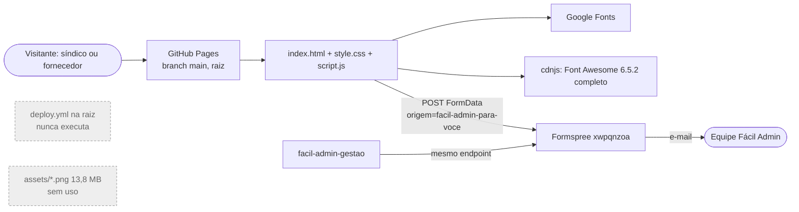
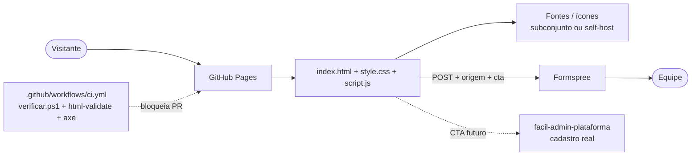

# 02 · Plano e arquitetura — facil-admin-para-voce

> 27/10/2026. Complementa `docs/ARQUITETURA.md` e `docs/PLANO-DE-ACAO.md` (ciclo de 27/09/2026), sem substituí-los.

## 1. Arquitetura atual

## 2. Arquitetura alvo (sem mudar o produto)

## 3. Decisões (ADR curto)

| ADR | Contexto | Decisão | Consequência |
|---|---|---|---|
| ADR-C01 | Lote 1 deve ser seguro e o pedido proíbe instalar dependências e rodar builds. | Lote 1 = **só documentação + script de verificação**. Nenhum arquivo do site alterado. | Zero risco ao produto publicado. Melhorias de código ficam como propostas com critério de pronto. |
| ADR-C02 | O pedido permite CI só com scripts que já existem; o repositório não tem nenhum (`package.json` ausente). | **Não** criar `ci.yml` no lote 1. | Proposta L2-01 usa `docs/claudeia/verificar.ps1` (criado agora) quando o dono aprovar. |
| ADR-C03 | `lang="pt-BR"` e `meta description` já existem (`index.html:2`, `8`); não há `localStorage`/`JSON.parse` no JS. | Nada a fazer nesses itens. | Registrado para evitar retrabalho de outros revisores. |
| ADR-C04 | Formulário com 5 campos obrigatórios é atrito aparente, mas é a captura e qualificação do lead (regra de negócio). | Manter todos os campos; propor apenas aperfeiçoamentos (pré-seleção de perfil, campo `cta`). | Preserva a medição do funil. |
| ADR-C05 | PNG e `deploy.yml` mortos não podem ser apagados por esta revisão. | Proposta para o dono executar com `git rm`. | Peso do repositório só cai após ação do dono. |

## 4. Plano em lotes

Esforço: P (≤ 1 h), M (≤ 4 h), G (> 4 h). Risco: risco de regressão visual/funcional.

| ID | Item | Motivo | Arquivos | Critério de pronto | Esforço | Risco | Muda o produto? | Situação |
|---|---|---|---|---|---|---|---|---|
| L1-01 | Relatório de revisão | Diagnóstico com evidência | `docs/claudeia/01-relatorio.md` | Arquivo existe com notas e falhas | P | Nenhum | Não | **Executado no lote 1** |
| L1-02 | Plano e arquitetura | Ordenar trabalho | `docs/claudeia/02-plano-e-arquitetura.md` | Este arquivo | P | Nenhum | Não | **Executado no lote 1** |
| L1-03 | Registro de execução | Rastreabilidade | `docs/claudeia/03-registro.md` | Arquivo existe | P | Nenhum | Não | **Executado no lote 1** |
| L1-04 | Script de verificação estática | Única verificação automatizável sem dependências | `docs/claudeia/verificar.ps1`, `04-testes-automatizados.md` | `pwsh docs/claudeia/verificar.ps1` termina com código 0 | P | Nenhum | Não | **Executado no lote 1** |
| L1-05 | Roteiro de teste manual | Cobrir o que o script não cobre | `docs/claudeia/05-testes-manuais.md` | Arquivo existe | P | Nenhum | Não | **Executado no lote 1** |
| L2-01 | CI com `verificar.ps1` | Pegar link/arquivo quebrado em PR | `.github/workflows/ci.yml` | Workflow verde em PR; vermelho se um `src` apontar para arquivo inexistente | P | Baixo | Não | Proposto |
| L2-02 | Remover PNG mortos | 13.790.207 bytes publicados sem uso | `assets/*.png` | `git rm`; `verificar.ps1` continua verde | P | Baixo | Não | Proposto (ação do dono) |
| L2-03 | Remover ou mover `deploy.yml` | Workflow morto contradiz README | `deploy.yml` | Decidir: apagar (publicação por branch, como em `docs/DEPLOY.md`) ou mover para `.github/workflows/` e trocar a origem no Pages | P | Baixo | Não | Proposto (ação do dono) |
| L2-04 | Atualizar README | Hero "widget", "depoimentos reais", 169 KB | `readme.md` | README bate com `index.html` atual | P | Nenhum | Não (texto de repositório) | Proposto |
| L2-05 | `aria-hidden="true"` nos 15 ícones restantes; `aria-label` nos botões "+" | Leitor de tela | `index.html` | `grep` não encontra `<i class="fa…"></i>` sem `aria-hidden`; axe 0 violações | P | Muito baixo | Não (invisível) | Proposto |
| L2-06 | Anunciar só o item visível ao girar listas | `aria-live` relê a lista inteira | `script.js:72-78` | NVDA lê 1 item por clique | P | Baixo | Não | Proposto |
| L2-07 | `.gitattributes` / `.editorconfig` com EOL definido | EOL misto (LF e CRLF) | novos | Novos commits sem troca de EOL | P | Baixo | Não | Proposto |
| L3-01 | Subconjunto do Font Awesome (ou SVG inline) e Poppins com `preload` | CSS de terceiros bloqueia renderização | `index.html`, novo `assets/icons` | Mesmos 34 ícones visíveis; LCP menor no Lighthouse | M | Médio | Não (visual idêntico) | Proposto |
| L3-02 | Limpar CSS duplicado/morto e mover estilos inline | 34 seletores repetidos, 7 classes sem uso, 21 `style=""` | `style.css`, `index.html` | Comparação de capturas antes/depois sem diferença | M | Médio | Não | Proposto |
| L3-03 | Testes E2E (Playwright + axe) | Regressão do formulário e do orçamento | novo `tests/`, `package.json` | CI roda E2E headless | G | Baixo | Não | Proposto (exige dependências) |
| P-01 | Canal de WhatsApp real ou frase ajustada | Promessa sem canal | `index.html:807`, `895`, `script.js:130` | Link abre conversa ou frase não cita WhatsApp | P | Baixo | **Sim** | Proposto · decisão de produto |
| P-02 | Redação de "Oficial/Homologada" em pré-lançamento | Coerência com faixa ilustrativa | `index.html:48`, `62`, `598` | Textos no futuro ou cobertos por aviso | P | Baixo | **Sim** | Proposto · decisão de produto |
| P-03 | Pré-selecionar "fornecedor" nos CTAs de empresa | Menos digitação e lead melhor classificado | `index.html:59`, `161`, `script.js` | Clicar em "Cadastrar Minha Empresa" abre form com perfil fornecedor | P | Baixo | **Sim** (comportamento) | Proposto · decisão de produto |
| P-04 | Campo oculto `cta` com a seção de origem | Medir qual seção converte | `index.html`, `script.js` | E-mail do Formspree traz `cta` | P | Baixo | **Sim** (dado coletado) | Proposto · decisão de produto |
| P-05 | Endpoint Formspree próprio ou compartilhado | Separação de leads com `gestao` | `index.html:811` | Decisão registrada | P | Baixo | **Sim** | Proposto · decisão de produto |
| P-06 | CTAs apontando para a plataforma quando publicada | Fechar o funil com `facil-admin-plataforma` | `index.html` | Links válidos para o cadastro real | M | Médio | **Sim** | Proposto · decisão de produto |
| P-07 | Links sociais reais | 3 links `href="#"` | `index.html:893-895` | Links abrem perfis reais | P | Nenhum | **Sim** | Proposto · decisão de produto |
