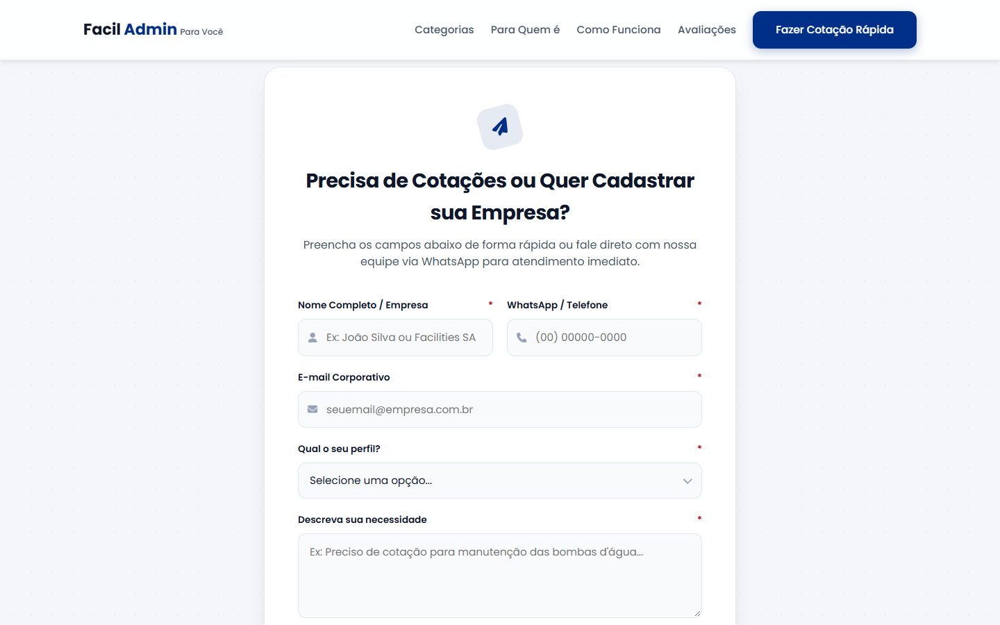

# 🏢 Facil Admin Para Você 

Plataforma oficial de matching e conexão entre síndicos/condomínios e fornecedores/prestadores de serviços especializados no setor de facilities. 

Desenvolvida com foco em alta conversão, design moderno e experiência de usuário fluida.

**▶ [Abrir a demonstração no ar](https://douglasabnovato.github.io/facil-admin-para-voce/)** · GitHub Pages, publicado a partir da `main`.


## Experimente em 30 segundos

1. Abra a [demonstração](https://douglasabnovato.github.io/facil-admin-para-voce/).
2. Clique em **Quero Encontrar Fornecedores** (síndico) ou **Cadastrar Minha Empresa** (fornecedor).
3. Preencha o formulário de cotação: nome, WhatsApp e o que precisa. O envio vai pelo Formspree.

## Telas

Capturas da demonstração publicada em 23/11/2026, em 360 px (celular) e 1440 px (computador). Preços, selos e depoimentos da página são ilustrativos (ver "Conteúdo ilustrativo").

| | Celular (360 px) | Computador (1440 px) |
|---|---|---|
| **Início** |  |  |
| **Cotação** |  |  |

---

> **Estado em 16/11/2026:** Página estática no GitHub Pages. O envio usa o Formspree. Testes: `npm ci`, `npx playwright install chromium` e `npm test` (Node 22.12 ou mais novo), com o Formspree simulado. Veja [Estado e próximos passos](#estado-e-próximos-passos-ciclo-de-16112026) e [docs/MVP.md](docs/MVP.md).

## 🚀 Sobre o Projeto

O **FacilAdmin Para Você** faz parte do ecossistema de gestão inteligente, resolvendo uma das maiores dores do mercado condominial: a lentidão e a falta de transparência na contratação de produtos e serviços de facilities (manutenção predial, portaria, limpeza, engenharia preventiva, entre outros).

A interface foi estruturada com base em padrões de design de grandes plataformas e e-commerces, unindo blocos de alta visibilidade, cartões modulares responsivos e identidade visual voltada para a confiança e a conversão rápida de leads.

---

## 🎨 Identidade Visual & Design System

Inspirado em padrões corporativos e de grandes players de mercado:
* **Azul Royal Vibrante (`#002F87`):** Transmite solidez, tecnologia e segurança nos blocos principais e cabeçalhos.
* **Verde Esmeralda (`#059669`):** Utilizado em gatilhos de conversão, botões de submissão e indicadores de sucesso.
* **Cinza Gelo (`#F4F6F9`):** Fundo limpo que reduz o cansaço visual e garante respiro estético.
* **Tipografia:** Família *Poppins* com hierarquia rigorosa e *font-smoothing* otimizado.

---

## 📄 Relatório de Seções Implementadas

Abaixo está o mapeamento completo e ordenado das seções presentes na arquitetura atual do arquivo `index.html`:

1. **Header Global:** Cabeçalho fixo contendo a logomarca estruturada, menu de navegação por âncoras, botão de ação rápida e menu hamburger para dispositivos móveis.
2. **Dobra 1 (Hero Section):** Proposta de valor central, selo oficial de matching, subtítulo explicativo, botões de chamada dupla (para gestores e fornecedores) e o painel dinâmico/widget de matching em tempo real.
3. **Dobra 2 (Vitrine de Categorias):** Exposição das principais necessidades do setor (Manutenção Predial, Limpeza & Conservação, Portaria & CFTV, Engenharia Preventiva) complementada por uma barra de busca rápida por subsetores.
4. **Dobra 3 (Segmentação de Personas):** Cards modulares interativos focados em separar a jornada e as vantagens exclusivas para *"Condomínios e Síndicos"* versus *"Fornecedores e Prestadores"*.
5. **Seção de Plantão de Ofertas:** Faixas de oportunidades com destaques comerciais (plantão de manutenção, descontos em reformas) e vitrine circular de categorias com selos de desconto.
6. **Seção de Serviços e Produtos Sob Medida:** Cards detalhados com seletores de métricas comerciais, contadores de quantidade dinâmicos e preços transparentes para pacotes recorrentes.
7. **Seção de Destaques do Mercado Condominial:** Listas compactas organizadas em três frentes de valor: Mais Contratados, Tendências em Facilities e Fornecedores Recém-Chegados à rede.
8. **Nova Seção de Galeria de Uso (Prova Social Visual):** Grid de quatro imagens contextuais humanizadas com imagens ilustrativas de síndicos, gestores e prestadores operando o FacilAdmin em cenários cotidianos diversos (shopping, condomínio residencial, escritório e recepção).
9. **Seção de Prova Social e Avaliações:** Depoimentos de gestores, síndicos profissionais e diretores de operações da rede integrados com notas máximas em estrelas.
10. **Dobra 5 (Como Funciona):** Linha do tempo dividida em 5 passos lógicos e intuitivos, cobrindo desde a inserção da demanda até a avaliação mútua e fechamento.
11. **Dobra 6 (Diferencial de Velocidade):** Bloco focado em combater a lentidão e a burocracia do modelo tradicional de cotações, acompanhado de um widget interativo atualizado com 4 itens de matching em tempo real.
12. **Dobra 7 (Conversão e Contato Imediato):** Formulário inteligente para submissão direta, integrado com validação de campos, seletor de perfil e feedback dinâmico de sucesso.
13. **Footer Global:** Rodapé institucional com direitos autorais e links para redes sociais com transições fluidas.

---

## 🛠️ Tecnologias Utilizadas

* **HTML5 Semantic:** Estruturação orientada a boas práticas, semântica e acessibilidade web.
* **CSS3 Moderno:** Custom Properties (variáveis globais via `:root`), CSS Grid, Flexbox e design responsivo blindado (*Mobile First*).
* **JavaScript (ES6+):** Controle programático do menu mobile responsivo, rolagem suave de âncoras e submissão assíncrona de formulários com feedback de estado.
* **FontAwesome & Google Fonts:** Repositório de ícones vetoriais em escala e tipografia corporativa de alta legibilidade.

---

## 📐 Arquitetura do Projeto

A organização de diretórios e arquivos foi planejada para manter o código limpo, modular e de fácil manutenção:

```text
FACIL-ADMIN-PARA-VOCE/
├── assets/                          # Recursos visuais (WebP otimizado, 1000 px)
│   ├── facil-admin-para-voce-1.webp # Síndica no condomínio
│   ├── facil-admin-para-voce-2.webp # Empreendedor no shopping
│   ├── facil-admin-para-voce-3.webp # Gestor no escritório
│   └── facil-admin-para-voce-4.webp # Administradora na recepção (hero)
├── .nojekyll                        # Arquivo vazio essencial que desativa o processador Jekyll do GitHub Pages
├── docs/                            # Análise, arquitetura e plano de ação do MVP
├── index.html                       # Arquivo principal contendo todas as dobras e a semântica da página
├── privacidade.html                 # Como os dados do pedido de orçamento são tratados (LGPD)
├── tests/                           # Testes Playwright: fluxo, foco e acessibilidade (axe)
├── readme.md                        # Documentação completa e estruturada do projeto
├── script.js                        # Controladores lógicos, menu mobile e submissão assíncrona
└── style.css                        # Folha de estilos customizada e Design System unificado
```

## 🎯 Estratégia de Marketing e Desenho da Landing Page

A concepção visual e estrutural da landing page seguiu premissas rigorosas de Growth Hacking e Product Management para maximizar a conversão de tráfego em leads qualificados:

* **Princípio da Clareza Imediata (Regra dos 3 Segundos):** A Dobra 1 (Hero) entrega instantaneamente o que a plataforma faz, eliminando barreiras de compreensão e direcionando os dois públicos-alvo (compradores de serviços e vendedores) para caminhos específicos.

* **Redução de Fricção no E-commerce de Serviços:** A inclusão de vitrines de produtos com preços visíveis, seletores de métricas e cartões de plantão mimetiza a experiência de consumo de grandes varejistas (estilo Carrefour/Amazon), gerando familiaridade instantânea.

* **Prova Social Visual (Humanização da Tecnologia):** O uso da galeria de uso real com fotos de perfil em ambientes diversos (shopping, condomínio, escritório) quebra a barreira da desconfiança digital, gerando identificação projetiva imediata com o usuário.

* **Arquitetura de Escaneabilidade (F-Shaped Pattern):** O uso de ícones destacados, badges de escassez/desconto e listas compactas permite que síndicos e administradores — que possuem rotinas altamente corridas — absorvam os benefícios da rede em poucos segundos de rolagem.

* **Foco Obsessivo na Conversão:** A jornada do usuário foi desenhada como um funil progressivo que culmina no formulário de contato, estrategicamente antecedido por gatilhos de velocidade, validação de mercado e depoimentos reais.

## 📄 Licença
Desenvolvido por LearnTECH & FacilAdmin © 2026. Todos os direitos reservados.

*feito por LearnTECH*

---

## Estado e próximos passos (ciclo de 16/11/2026)

Página publicada (HTTP 200 em 16/11/2026): https://douglasabnovato.github.io/facil-admin-para-voce/

**Estado em 16/11/2026:** Vitrine (N2), 10 de 12 critérios atendidos; **Finalizado: sim**. Os 2 parciais dependem do responsável: a conta do GoatCounter (#19) e o prazo de guarda e o contato de privacidade (#33). Os alertas do Dependabot foram ligados em 16/11/2026 e mostram 0 abertos (15h06), com `npm audit --omit=dev` sem vulnerabilidades. A `main` exige os jobs `fluxo` e `links` verdes. Detalhes em [docs/MVP.md](docs/MVP.md).

### O que foi feito

- axe-core no CI, no computador e no celular, com o contraste medido também no texto sobre degradê; o selo do topo passou de 3,1:1 para 5,6:1 ([#22](https://github.com/douglasabnovato/facil-admin-para-voce/issues/22), [#34](https://github.com/douglasabnovato/facil-admin-para-voce/issues/34), [PR #35](https://github.com/douglasabnovato/facil-admin-para-voce/pull/35)).
- Página de privacidade ligada ao formulário: dados pedidos, finalidade, quem recebe e como pedir a exclusão ([#23](https://github.com/douglasabnovato/facil-admin-para-voce/issues/23), PR #35).
- Critério 9 revisto: com os alertas do Dependabot ligados (0 abertos, 16/11/2026 15h06), segue Parcial só pela página de privacidade (#33).
- LCP móvel medido de novo no site publicado, já com este ciclo na `main`: mediana 1,55 s (18/11/2026; era 2,20 s em 16/11), [#36](https://github.com/douglasabnovato/facil-admin-para-voce/issues/36).
- Medição com GoatCounter pronta no código, sem cookie e só no site publicado, e teste dos avisos de conteúdo ilustrativo ([#31](https://github.com/douglasabnovato/facil-admin-para-voce/pull/31)).
- `main` protegida, com os jobs `fluxo` e `links` obrigatórios ([#29](https://github.com/douglasabnovato/facil-admin-para-voce/pull/29)).
- Foco visível com contraste de 3:1, fonte local, `srcset` e pedido com vários pacotes ([#25](https://github.com/douglasabnovato/facil-admin-para-voce/pull/25)).

### O que queremos fazer

Com o responsável:

- Criar a conta do GoatCounter com o código `douglasabnovato` ([#19](https://github.com/douglasabnovato/facil-admin-para-voce/issues/19)).
- Fechar a issue dos alertas do Dependabot, já ligados e sem alerta aberto em 16/11/2026 ([#32](https://github.com/douglasabnovato/facil-admin-para-voce/issues/32)).
- Definir o prazo de guarda e o contato de privacidade ([#33](https://github.com/douglasabnovato/facil-admin-para-voce/issues/33)).
- Confirmar preços, selos, avaliações e depoimentos para tirar os avisos de ilustrativo ([#17](https://github.com/douglasabnovato/facil-admin-para-voce/issues/17)).
- Enviar um pedido real e testar com alguém de fora ([#20](https://github.com/douglasabnovato/facil-admin-para-voce/issues/20)).
- Decidir o destino do `deploy.yml` solto na raiz ([#24](https://github.com/douglasabnovato/facil-admin-para-voce/issues/24)).

Com o agente:

- Medir o contraste das setas do carrossel e das estrelas das listas ([#41](https://github.com/douglasabnovato/facil-admin-para-voce/issues/41)).
- Conferir o LCP a cada PR com o Lighthouse no CI ([#42](https://github.com/douglasabnovato/facil-admin-para-voce/issues/42)).
- Tirar os 4 PNG não usados, com aval do responsável ([#21](https://github.com/douglasabnovato/facil-admin-para-voce/issues/21)).

### Onde está a documentação

- Estado e critérios: [docs/MVP.md](docs/MVP.md).
- Plano do ciclo: [docs/PLANO-DE-ACAO.md](docs/PLANO-DE-ACAO.md#ciclo-de-16112026).
- Publicação: [docs/DEPLOY.md](docs/DEPLOY.md).
- Privacidade: [privacidade.html](privacidade.html).

### Rodar os testes

Precisa do Node 22.12 ou mais novo (exigência do `@axe-core/playwright` 4.14).

```bash
npm ci
npm run links
npx playwright install chromium
npm test
```

Para usar outra porta local (o padrão é 4173): no Git Bash, `PORT=4300 npm test`; no PowerShell, `$env:PORT=4300; npm test`.

---

## ⚠️ Conteúdo ilustrativo (L1 — set/2026)

A plataforma está em pré-lançamento. Preços, selos, avaliações, depoimentos e números da página são **exemplos** e estão sinalizados na própria página (faixa no topo e avisos por seção). A seção de marcas foi trocada pelas categorias da rede em formação: nenhuma marca de terceiros é exibida.

## 🌐 Em produção

**Demonstração:** https://douglasabnovato.github.io/facil-admin-para-voce/

- GitHub Pages publicando a branch `main` (pasta raiz), sem build e sem workflow; `.nojekyll` desliga o Jekyll.
- O formulário envia pelo Formspree (campos ocultos `origem` e `_subject` identificam este site).
- Passo a passo completo: [docs/DEPLOY.md](docs/DEPLOY.md).

## 📊 Estado do MVP & Documentação

| Documento | Conteúdo |
|---|---|
| [docs/ANALISE.md](./docs/ANALISE.md) | Requisitos, diagnóstico, rubrica e notas |
| [docs/ARQUITETURA.md](./docs/ARQUITETURA.md) | C4, contrato do lead e ADRs |
| [docs/PLANO-DE-ACAO.md](./docs/PLANO-DE-ACAO.md) | Tarefas priorizadas por MoSCoW |

| Momento | Nota MVP | Situação |
|---|---|---|
| Antes (27/09/2026) | 4,01 | Reprovado — 13,7 MB de imagens, controles sem ação e publicação automática inativa |
| Depois (27/09/2026) | 7,84 | Aprovado — faltam mover o workflow e decidir como rotular preços e avaliações |

> **Publicação:** GitHub Pages direto da branch `main`, pasta raiz, sem workflow. Passo a passo em [docs/DEPLOY.md](docs/DEPLOY.md).
